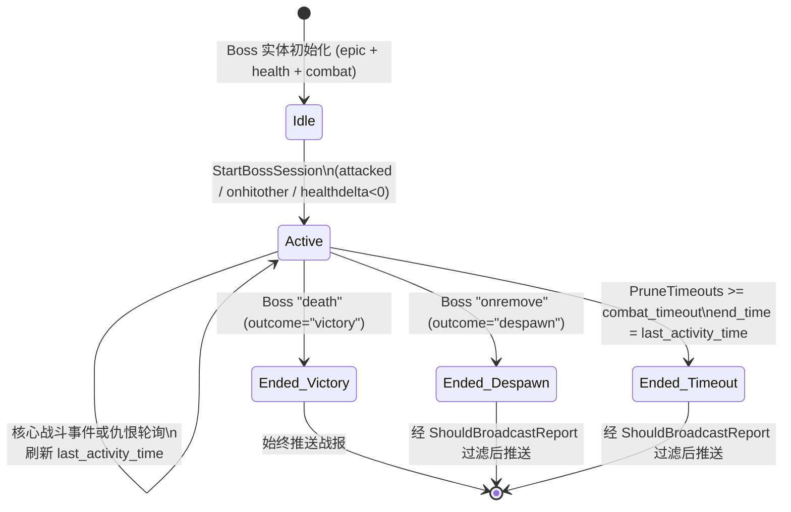

# 统计生命周期与边界规范（Session Boundaries）

本文档定义 BossMeter 在 Boss 战统计中的**开始、续期、归因隔离、结束与战报过滤**契约。所有采集器（`scripts/bossmeter/metrics/`）、会话管理（`scripts/bossmeter/core/session.lua`）与同步层（`scripts/bossmeter/net/sync.lua`）的改动均须遵守本规范。

---

## 1. 会话状态机

---

## 2. 四大核心边界规则

### 2.1 Boss 识别与开始条件
- **识别范围**：`AddPrefabPostInitAny` 过滤同时满足 `inst:HasTag("epic")`、`inst.components.health`、`inst.components.combat` 的实体，以 `inst.GUID` 作为唯一 `boss_id`。
- **开始触发**（`StartBossSession` 幂等，已存在则不重复触发 `OnSessionStart`）：
  1. Boss `attacked` 且 `data.attacker` 可通过 `Attribution.ResolvePlayer` 追溯到玩家。
  2. Boss `onhitother` 且 `data.target` 具有 `"player"` 标签。
  3. Boss `healthdelta`（`amount < 0`）且 `data.afflicter` 可追溯到玩家。
  4. 外部 Mod 显式调用 `GLOBAL.BossMeter.StartBossSession(...)`。

### 2.2 参战隔离与事件归因（`Attribution.ResolveRelevantBoss`）
玩家侧指标（承伤、死亡、治疗、护甲减伤/耐久、消耗品）禁止无条件归入全服最近活跃 Boss，必须通过 `Attribution.ResolveRelevantBoss(player, collector, preferred_boss_id, max_dist)` 判定归属：
1. 若存在显式攻击/致死来源（`preferred_boss_id`）且其对应会话活跃，直接归入该 Boss。
2. 否则玩家必须满足以下条件之一：
   - 与该 Boss 实体的距离 `<= 40` 码（默认参与半径）；
   - 在该会话的 `combat_players` 中存在直接战斗交互记录。
3. 多 Boss 同时满足时，优先选择最近发生直接战斗交互的 Boss，其次选择距离最近的 Boss。
4. 不满足条件的基地玩家或远距离未参战玩家返回 `nil`，数据不记入任何战报。

### 2.3 脱战续期与超时时长
- **续期白名单**（仅以下行为允许刷新 `session.last_activity_time`）：
  1. 玩家对 Boss 造成有效伤害（`damage.lua`）。
  2. Boss 直接攻击玩家（`damage.lua` 的 `onhitother` 与 `survival.lua` 中 `attacker == boss` 的 `attacked`）。
  3. 每 5 秒 `PruneTimeouts` 轮询前，检测到活跃 Boss 的 `combat.target` 仍可追溯到玩家时，调用 `TouchSession` 防止风筝拉扯期间误脱战。
- **非续期行为**：纯玩家侧行为（`healing_done`、`mitigation`、`armor_loss`、`consumables_used`、`deaths` 以及非 Boss 本体的杂兵/环境 `damage_taken`）须传入 `{ touch_activity = false }`，防止玩家在基地回血或吃东西无限延长战斗。
- **超时结束时间**：`PruneTimeouts` 触发 `outcome = "timeout"` 时，`end_time` 必须取 `session.last_activity_time`（最后一次有效战斗时刻），严禁把脱战等待的 `combat_timeout` 秒数计入战斗时长和 DPS 分母。

### 2.4 多 Boss 状态与微战报过滤
- **多 Boss HUD 状态**：`BossState` RPC 携带 `boss_id`，客户端 `store` 通过 `active_bosses` 集合维护活跃状态，单个 Boss 结束不会清除另一只仍在战斗的 Boss 提示。
- **无效微战报过滤（`Sync.ShouldBroadcastReport`）**：
  - `outcome == "victory"` 始终推送；
  - `timeout` / `despawn` 须满足：有有效伤害（`damage_total.grand_total > 0` 且 `duration >= 3` 秒），或有 `deaths` 记录，或包含外部自定义指标；路过擦边摸一下即脱战的微战报不推送。
